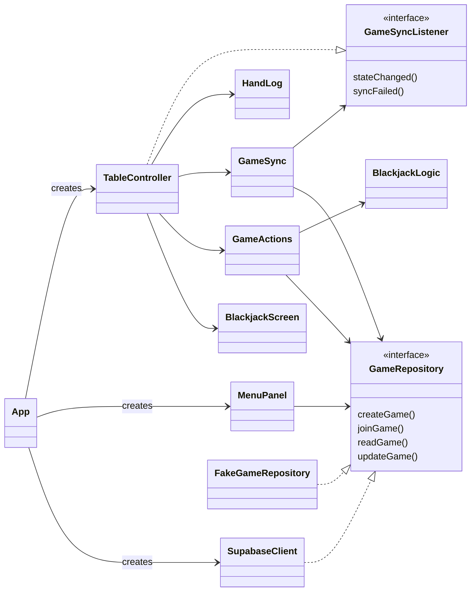
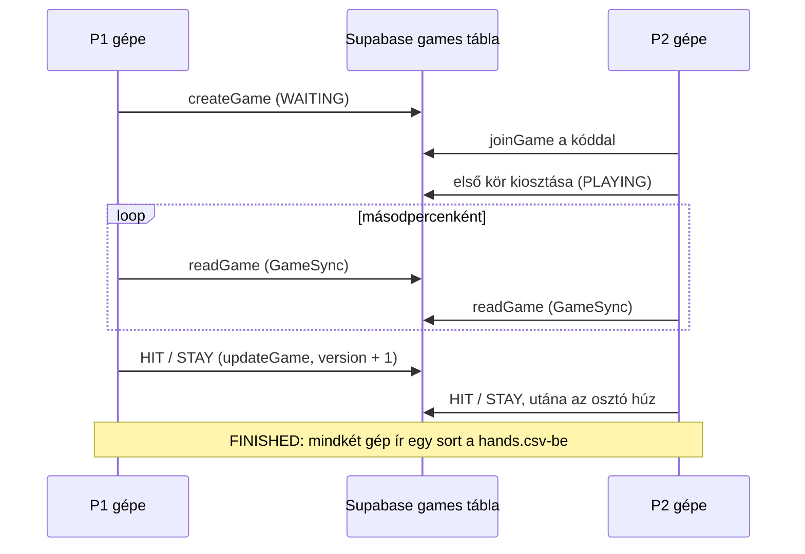

# BlackJackProjectOOP

Kétjátékos online blackjack Java Swing felülettel. A két játékos két külön gépen ül, a gépek egy közös Supabase táblán keresztül játszanak, az osztót (dealer) a program játssza.
Egyetemi OOP projekt (Student A: Gabi, Student B: boldi).

## Előfeltételek

- JDK 11 vagy újabb
- Apache NetBeans (beépített Maven)
- Internetkapcsolat (Supabase)

## Supabase beállítása (egyszer kell)

1. Hozz létre egy ingyenes projektet a supabase.com oldalon.
2. Nyisd meg a **SQL Editor**-t, másold be a [`supabase/schema.sql`](supabase/schema.sql) teljes tartalmát, és futtasd le (Run). Ez létrehozza a `games` táblát, a hozzáférési szabályokat (RLS) és a verziót ellenőrző triggert.
3. **Authentication > Sign In / Providers**: kapcsold be az **Allow anonymous sign-ins** opciót. A program így kap egy azonosítót minden játékosnak, regisztráció nélkül.
4. **Project Settings > API Keys**: másold ki a Project URL-t és a **publishable** kulcsot (`sb_publishable_...`).

## config.properties

Másold le a `config.example.properties` fájlt `config.properties` néven a projekt mappájába, és írd bele a Supabase URL-t és a publishable kulcsot. A `config.properties` nem kerül fel a GitHubra (.gitignore). Secret kulcsot (`sb_secret_...`) a program nem fogad el.

## Indítás NetBeansből

1. File > Open Project, és válaszd ki a repó mappáját.
2. Run Project (F6). Megnyílik a menü.

## Futtatás NetBeans nélkül

1. NetBeansben: jobb klikk a projekten > Clean and Build. Elkészül a `target/Blackjack.jar` (a képek és az org.json is benne vannak).
2. Készíts egy mappát, és tedd bele a `Blackjack.jar`-t és a `config.properties`-t.
3. Ugyanebbe a mappába készíts egy `start.bat` fájlt ezzel a tartalommal:

```
@echo off
cd /d "%~dp0"
java -jar Blackjack.jar
pause
```

4. Dupla klikk a `start.bat`-ra. Java 11 vagy újabb kell hozzá.

## Játék

1. Az első játékos a **Create room** gombra kattint. A szoba kódja az ablak címében látszik (például `K7Q2`).
2. A kódot elmondja vagy elküldi a másik játékosnak. Ő beírja, és a **Join** gombra kattint, 30 másodpercen belül.
3. A második játékos gépe kiosztja a lapokat. A soron következő játékos HIT vagy STAY, a végén az osztó húz 17-ig.
4. A kör végén: **New round** vagy **Back to menu**.
5. Ha valaki 30 másodpercig nem lép (vagy senki nem lép be a szobába), a játék véget ér (TIMEOUT), és csak vissza lehet menni a menübe.

Egy gépen is ki lehet próbálni: a programot kétszer kell elindítani, így két ablak nyílik.

## hands.csv

Minden lezárt kör után a program egy sort ír a saját mappájában lévő `hands.csv` fájlba, a saját szemszögéből:

```
kor;sajat_kez;ellenfel_keze;dealer_keze;eredmeny
1;10-D,5-C,2-D;2-C,10-C,K-H;4-S,J-C,5-D;vesztett
```

## Tesztek

Test Project (Alt+F6). A tesztek a `FakeGameRepository`-t használják, ezért internet és `config.properties` nélkül is lefutnak.

## Csomagok

| Csomag | Tartalom |
| --- | --- |
| `blackjack` | App: ablak, képernyőcsere, itt jön létre minden valódi objektum |
| `blackjack.model` | GameState, GameStatus, Turn, MoveType, RoomCode, Card, Deck, Hand, Rank, Suit |
| `blackjack.logic` | BlackjackLogic, Outcome: a játék szabályai |
| `blackjack.net` | GameRepository, SupabaseClient, FakeGameRepository, GameSync, GameActions, AppConfig |
| `blackjack.storage` | HandLog: hands.csv írása |
| `blackjack.ui` | MenuPanel, TableController, BlackjackScreen, CardImages |

## Osztálydiagram



## Egy játék menete



Minden mentés csak akkor sikerül, ha a sor `version` értéke közben nem változott. Így a két gép nem írja felül egymás lépését.

## Ismert korlátok

- **Csalás:** a két játékos ugyanazt a sort olvassa a táblából, benne a teljes paklival és a dealer lefordított lapjával. Aki a programot megkerülve olvassa az adatbázist, előre láthatja a lapokat. Egyetemi projektnél ezt elfogadtuk: a pakli titokban tartásához szerver oldali kód kellene (például Edge Function), ami túlmutat a feladaton.
- **A szobakód nem jelszó:** aki tudja a kódot, be tud lépni, amíg a szoba szabad. Belépés után a sort csak a két játékos módosíthatja (RLS a `p1_id` és `p2_id` alapján).
- Az ingyenes Supabase projekt kb. egy hét használat nélkül szünetel. Ilyenkor a Supabase oldalán a **Restore** gombbal lehet újraindítani.

## Források

- Háttérkép: (src/main/resources/table.jpg): https://www.pexels.com/photo/a-blue-textured-background-15429341/
- Kártyaképek: (src/main/resources/cards): https://github.com/ImKennyYip/blackjack-java/tree/master/cards
